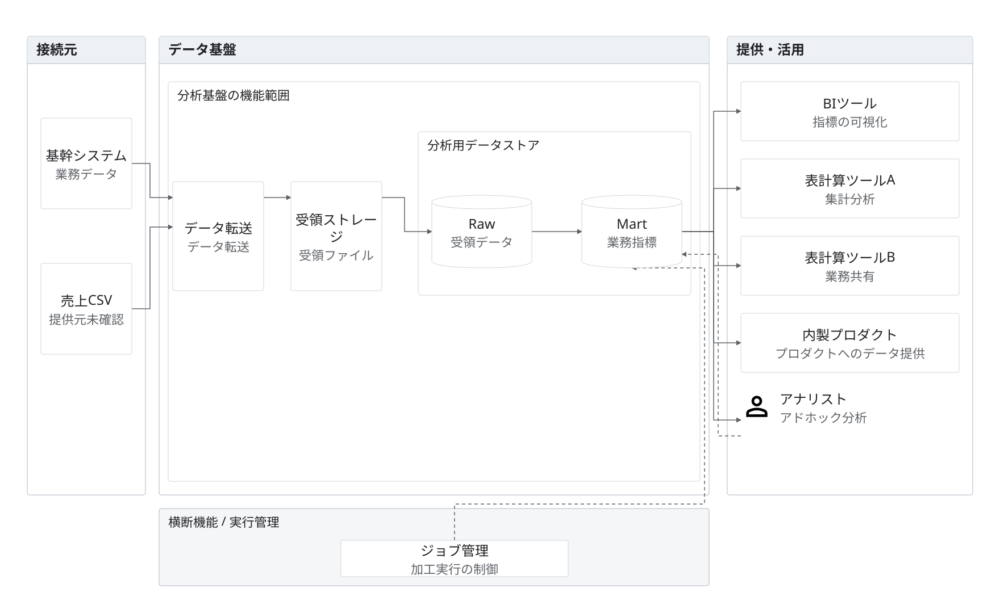

# 業務分析基盤の論理構成

架空の提案。業務データ・売上CSVを取り込み、受領ストレージからRaw・Martへ展開し、BI、表計算、内製プロダクト、アナリストへ提供する。接続方式・頻度・権限と、CSVの提供元は未確認。

接続元・基盤・利用先を名前付きの枠で示し、保存先の内部にRaw・Martを置く。製品を未指定とし、矩形と論理データの円柱で示す。単一の製品領域へ論理層をまとめ、実行管理を下部に配置する。

実線はデータ・参照結果、破線は実行制御。アナリストへのデータ提供と、アナリストからのクエリ指示は別の線で示す。どちらも任意の将来設計であり、実在する運用を意味しない。

編集元は[model.json](model.json)、完成図は[diagram.svg](diagram.svg)。`python3 examples/render.py`でSVGのみ再生成できる。両例は同じノードID・接続を維持し、製品表記とアイコンを変えている。1760×1080。掲載幅960pxでも表示を確認する。

[draw.io](diagram.drawio)・[Mermaid](diagram.mmd)はv2移行前の保存版であり、現行SVGとの同期対象外。利用条件・未確認事項は[素材の案内](../../assets/icons/README.md)と[正確性](../../docs/principles/accuracy.md)に従う。
