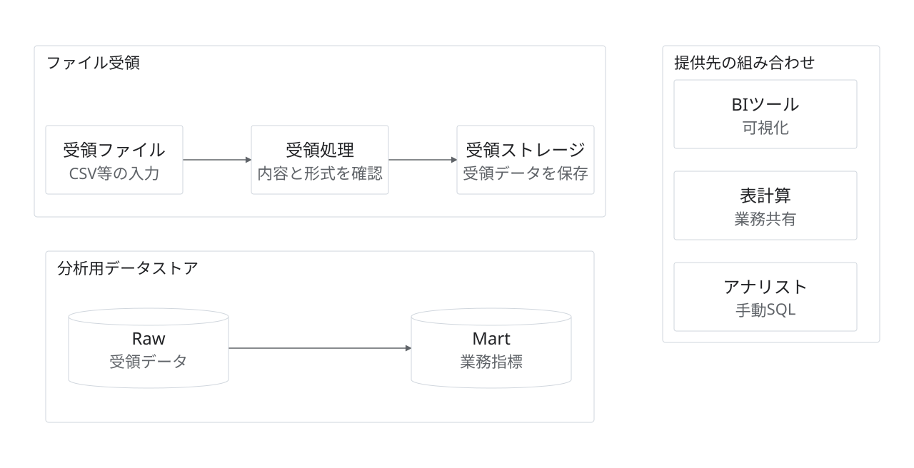

# 再利用部品の組み合わせ

状態：架空の提案・作図見本。実企業の稼働構成ではない。

目的・対象範囲：ファイル受領、Raw・Mart、BI・表計算・人を部品JSONから展開する。見本間は接続していない。

編集元：[model.json](model.json)。出力：[diagram.svg](diagram.svg)。`python3 examples/render.py`で上書き再生成する。

凡例：内部の実線はデータ移動。接続のない部品間に連携はない。

前提・未確認事項：各構成が実案件に存在する場合のみ採用する。製品・方式・所有者は未選定。

参照元：本リポジトリのデザインシステム。外部の実構成を示す出典はなし。
