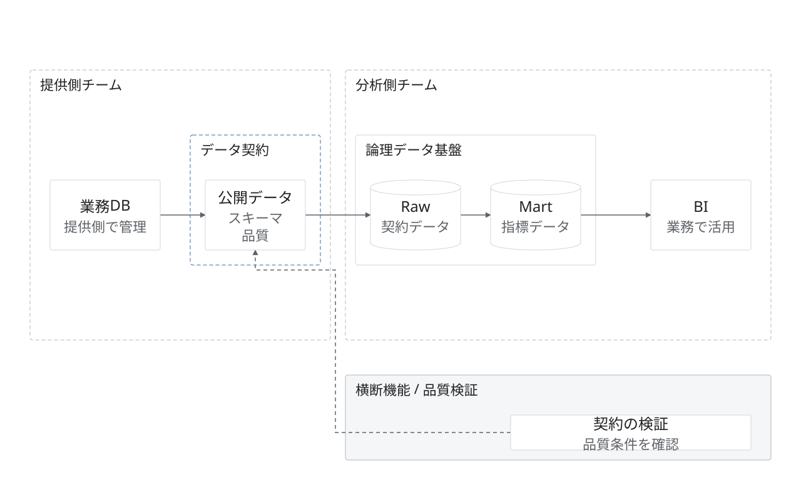

# データ契約と責任境界

架空の提案。提供側チームと分析側チームの境界に公開インターフェースを置き、下部に品質検査を配置する。

データの受け渡しは実線、検証の対象は破線。契約や枠を描いただけで検証・遮断が実装されているとは判断しない。契約・製品領域にはfit.membersを使い、内容から大きさを決める。製品・担当者・品質条件は架空の提案。

編集元は[model.json](model.json)、完成図は[diagram.svg](diagram.svg)。1280×800。`python3 examples/render.py`で再生成し、`python3 scripts/validate_diagrams.py`で検証する。実際の掲載寸法でも描画を確認する。
