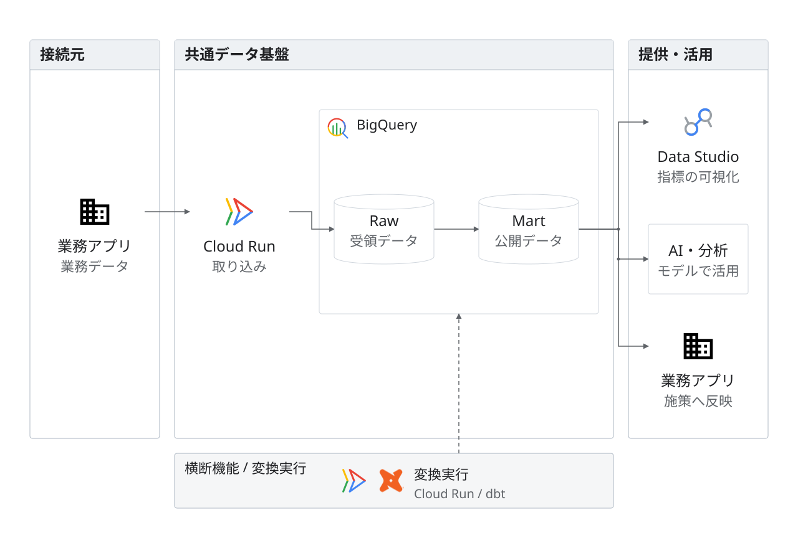

# BI・AI・業務への分岐

架空の提案。同じRaw・MartをBI、AI・分析、業務アプリで利用する。Cloud Run上のdbtによる変換実行を下部に置く。

左右の業務アプリは同じentity_idを持ち、入力と結果提供を別経路で示す。主経路の配置は左から右。AI製品や具体的な接続方式は未確定であり、推定したロゴは使わない。

編集元は[model.json](model.json)、完成図は[diagram.svg](diagram.svg)。1280×864。`python3 examples/render.py`で再生成し、`python3 scripts/validate_diagrams.py`で検証する。実際の掲載寸法でも描画を確認する。

dbt™はdbt Labsの商標。本図と作成者はdbt Labsと提携しておらず、同社の承認を示すものではない。[公式商標ポリシー](https://www.getdbt.com/dbt-assets/dbt-trademark-guidelines)に従い、シンボルの色・形を保持する。
