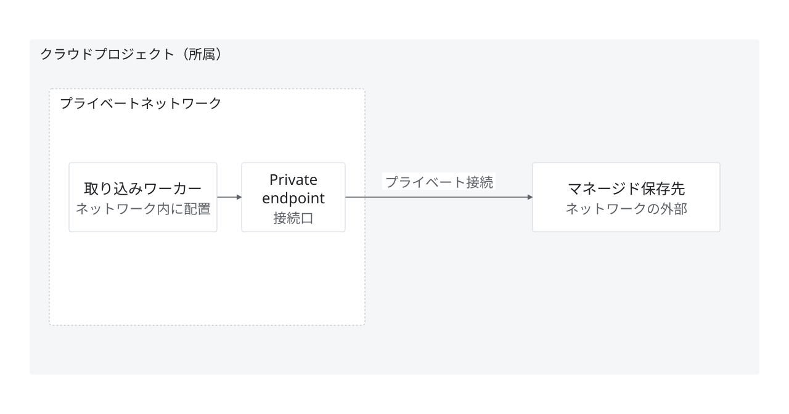

# 所属とネットワーク配置の区別

状態：架空の提案・作図見本。実企業の稼働構成ではない。

目的・対象範囲：同じプロジェクトに属しても、ワーカー・接続口とマネージド保存先の配置は異なることを示す。

編集元：[model.json](model.json)。出力：[diagram.svg](diagram.svg)。`python3 examples/render.py`で上書き再生成する。

凡例：点線枠は提案上のネットワーク範囲、実線はデータ経路。

前提・未確認事項：製品を特定しない説明用の提案。実ネットワーク・接続方式・権限は未確認。接続口の存在だけで到達性やセキュリティを保証しない。

参照元：本リポジトリのデザインシステム。外部の実構成を示す出典はなし。
