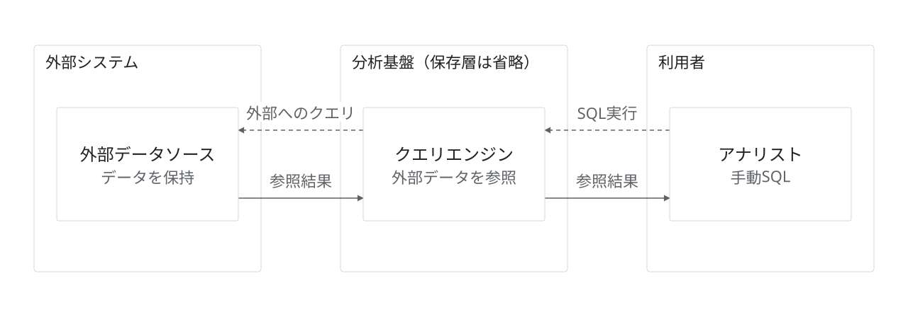

# コピーを伴わない外部照会

状態：架空の提案・作図見本。実企業の稼働構成ではない。

目的・対象範囲：アナリストの要求をクエリエンジンから外部へ送り、結果を利用者へ返す。

編集元：[model.json](model.json)。出力：[diagram.svg](diagram.svg)。`python3 examples/render.py`で上書き再生成する。

凡例：破線はクエリ実行要求、実線は参照結果。永続的なコピーを表す線はない。

前提・未確認事項：キャッシュ・一時領域の有無は対象外。接続方式・認証・製品は未定。

参照元：本リポジトリのデザインシステム。外部の実構成を示す出典はなし。
