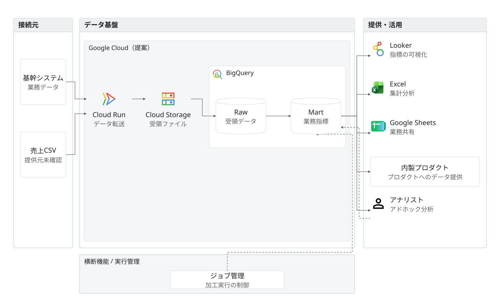

# Google Cloudを使った業務分析基盤

架空の提案。業務データ・売上CSVを取り込み、受領ストレージからRaw・Martへ展開し、BI、表計算、内製プロダクト、アナリストへ提供する。接続方式・頻度・権限と、CSVの提供元は未確認。

接続元・基盤・利用先を名前付きの枠で示し、保存先の内部にRaw・Martを置く。Cloud Run・Cloud Storage・BigQuery・Looker・Sheets・Excelは公式素材を使う。単一の製品領域へ論理層をまとめ、実行管理を下部に配置する。

実線はデータ・参照結果、破線は実行制御。アナリストへのデータ提供と、アナリストからのクエリ指示は別の線で示す。どちらも任意の将来設計であり、実在する運用を意味しない。

編集元は[model.json](model.json)（英語基準）・[日本語文言](locales/ja_jp.json)、完成図は[日本語](diagram.ja_jp.svg)・[英語](diagram.svg)。`cargo run --release -- examples --all-locales`でSVGのみ再生成できる。両例は同じノードID・接続を維持し、製品表記とアイコンを変えている。1760×1080。掲載幅960pxでも表示を確認する。

draw.io（[日本語](diagram.ja_jp.drawio)・[英語](diagram.drawio)）とMermaid（[日本語](diagram.ja_jp.mmd)・[英語](diagram.mmd)）は同じモデルから生成した派生物で、SVGと同じ`locales/ja_jp.json`を使う。手で直さず、モデルまたは翻訳ファイルを直して再生成する。利用条件・未確認事項は[素材の案内](../../assets/icons/README.md)と[正確性](../../docs/principles/accuracy.md)に従う。
