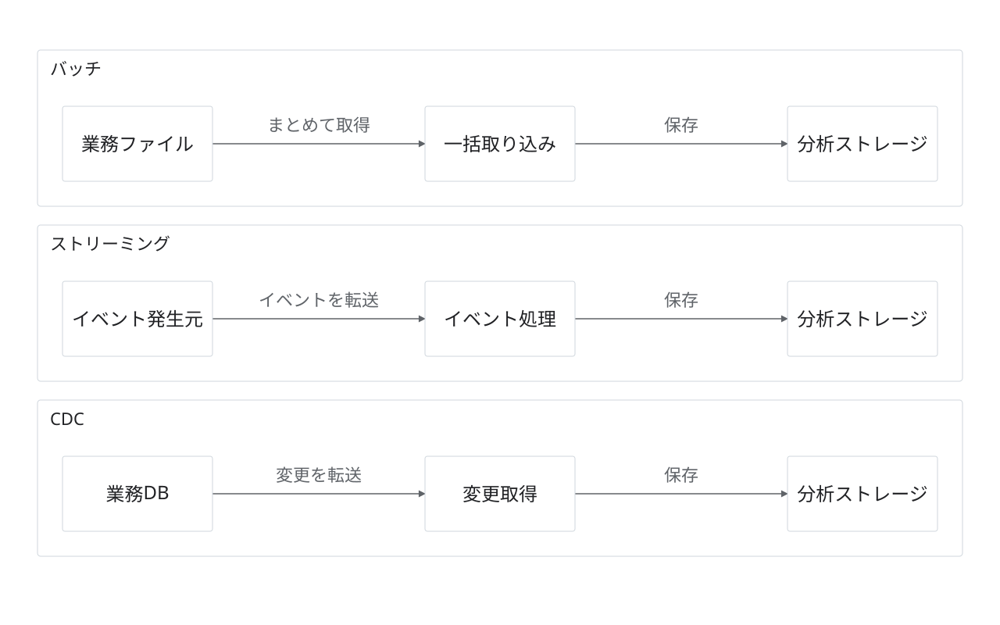

# 取り込み方式の比較

状態：架空の提案・作図見本。実企業の稼働構成ではない。

目的・対象範囲：バッチ・ストリーミング・CDCを独立した並行レーンで示す。

編集元：[model.json](model.json)。出力：[diagram.svg](diagram.svg)。`python3 examples/render.py`で上書き再生成する。

凡例：実線は転送。方式はラベルと領域名で区別する。

前提・未確認事項：3方式を同時導入する提案ではない。頻度・遅延・具体的製品は未定。CDCから頻度は推定しない。

参照元：本リポジトリのデザインシステム。外部の実構成を示す出典はなし。
