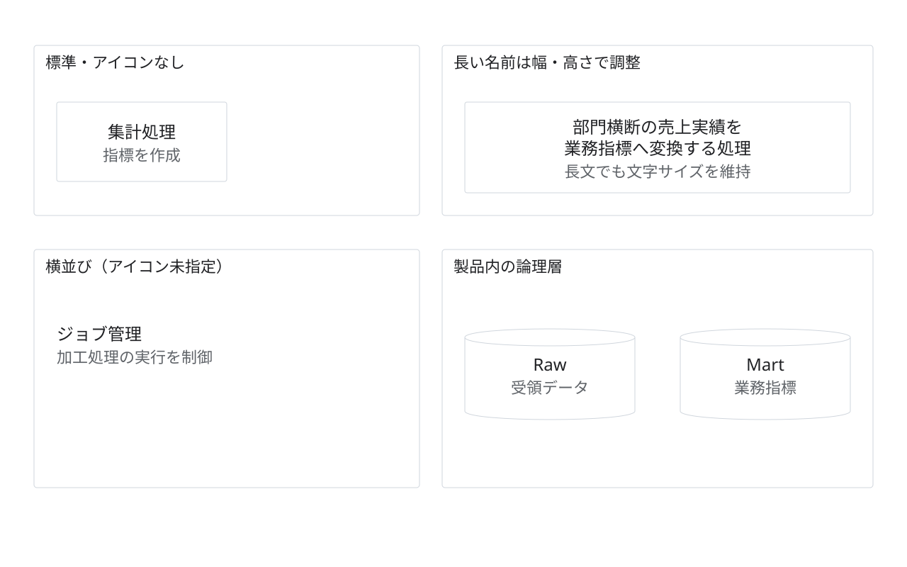

# ノードの状態別見本

状態：架空の提案・作図見本。実企業の稼働構成ではない。

目的・対象範囲：標準、長い名前、アイコンなし、横並び、製品内の入れ子を比較する。

編集元：[model.json](model.json)。出力：[diagram.svg](diagram.svg)。`python3 examples/render.py`で上書き再生成する。

凡例：線なし。製品領域は論理層を内包する。

前提・未確認事項：接続のない部品カタログ。実システムの構成を示さない。

参照元：本リポジトリのデザインシステム。外部の実構成を示す出典はなし。
