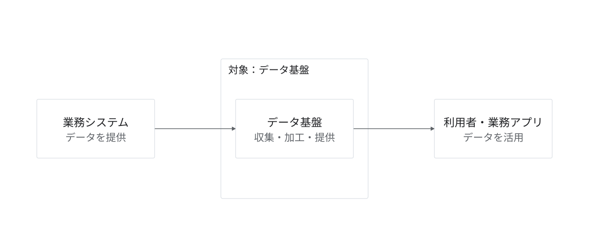

# データ基盤の全体像

状態：架空の提案・作図見本。実企業の稼働構成ではない。

目的・対象範囲：業務システムから基盤を経由して利用者・業務アプリへ届く範囲だけを示す。

編集元：[model.json](model.json)（英語基準）・[日本語文言](locales/ja_jp.json)。出力：[日本語](diagram.ja_jp.svg)・[英語](diagram.svg)。`cargo run --release -- examples --all-locales`で上書き再生成する。

凡例：実線はデータの提供。枠は作図の対象。

前提・未確認事項：内部の処理・保存層・ネットワークは省略。処理構成の例と自動同期するモデルではない。

参照元：本リポジトリのデザインシステム。外部の実構成を示す出典はなし。
