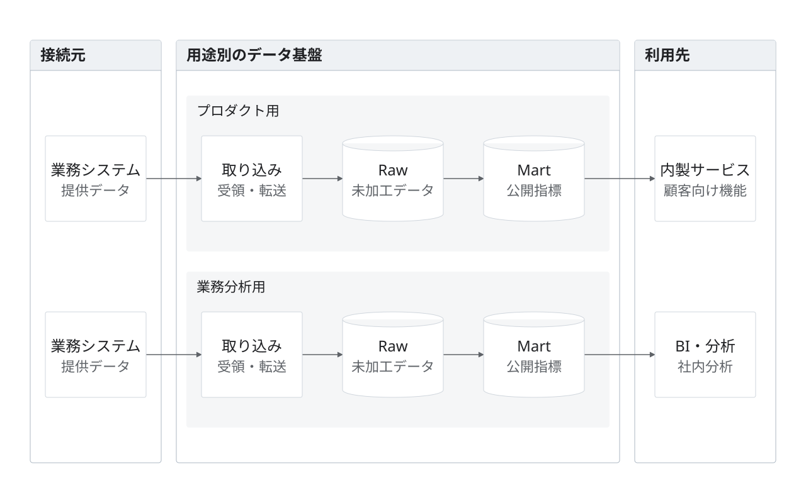

# 用途別のデータ基盤

架空の提案。プロダクト用と社内分析用を並行レーンへ分け、同じ工程を左から右に揃える。各レーンは異なる所属プロジェクトとして表現するが、例にあるプロジェクトは架空。

入力、取り込み、Raw、Mart、利用先をレーンごとに持つ。用途が異なるため別の実体としている。製品・頻度・権限・運用実態は未確定。

編集元は[model.json](model.json)、完成図は[diagram.svg](diagram.svg)。1280×800。`python3 examples/render.py`で再生成し、`python3 scripts/validate_diagrams.py`で検証する。実際の掲載寸法でも描画を確認する。
