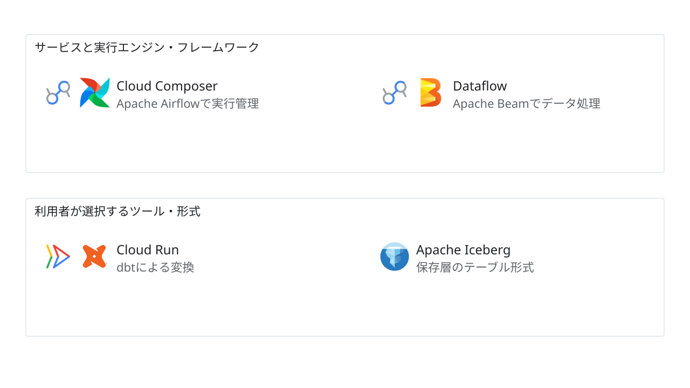

# 実行基盤と併用ソフトウェアの見本

状態：架空の提案・部品の組み合わせ見本。実企業の構成ではない。

目的・対象範囲：Cloud ComposerとAirflow、DataflowとBeam、Cloud Runとdbt、保存層のIceberg形式を並べ、基盤・エンジン・ツール・形式の役割を区別する。独立した例であり、一続きのパイプラインや同時採用を意味しない。

編集元：[model.json](model.json)。出力：[diagram.svg](diagram.svg)。`python3 examples/render.py`で再生成する。

凡例：枠は見本の分類。1ノードの複数アイコンは同じ処理の基盤とソフトウェア。接続線はなし。Icebergは実行基盤ではなくテーブル形式。

前提：この見本では示したツール・形式を提案として選んでいる。実案件では実装・設定・指定を確認する。

未確認事項：具体的なジョブ、バージョン、ネットワーク、所有者、保存先はなし／対象外。これらを実案件へ推定で補完しない。

参照元：[本システムのルール](../../docs/components/runtime-software.md)。公式素材の取得元・確認日・ハッシュ・利用条件は[manifest](../../assets/icons/manifest.json)。
